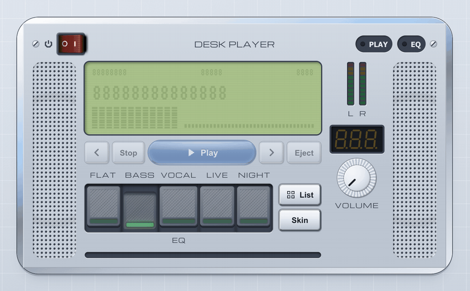

<h1 align="center">Frontpanel</h1>

<p align="center">
  An early-2000s hardware UI kit for building device front panels in the browser: liquid-chrome
  bezels, glossy gel buttons, molded caps, LCD readouts and LEDs, in plain CSS with Vue 3
  components on top. Two skins, Chrome Silver and Gunmetal Night, follow the system setting.
</p>

<p align="center">
  <a href="https://dulandev.github.io/frontpanel/"></a>
</p>

The UI kit behind [WhatsTheNextChord](https://whatsthenextchord.com).

**[Documentation](https://dulandev.github.io/frontpanel/)**: guides, live demos, and every
component, class and token.

> `0.x`, before 1.0: class names, tokens and props may still change between minor versions.

| Package | What it is |
| --- | --- |
| `@frontpanel/css` | Tokens, `.fp-*` classes, optional base styles, fonts and a Tailwind 4 entry |
| `@frontpanel/vue` | Vue 3 components built on [Reka UI](https://reka-ui.com) |
| `@frontpanel/music` | Coming: chord diagram, chord matrix, chord-type caps |

## Usage

```bash
npm install @frontpanel/css          # the skin, for any framework or none
npm install @frontpanel/vue          # Vue 3 components, which bring the css package
```

Plain CSS, everything in `@layer frontpanel`:

```css
@import "@frontpanel/css/index.css";  /* tokens and .fp-* classes */
@import "@frontpanel/css/fonts.css";  /* optional: the bundled fonts */
@import "@frontpanel/css/page.css";   /* optional: website pieces around a device */
@import "@frontpanel/css/base.css";   /* optional: page defaults */
```

Tailwind 4, where the tokens join the theme and the classes become utilities:

```css
@import "tailwindcss";
@import "@frontpanel/css/tailwind.css";
@import "@frontpanel/css/tailwind-page.css";  /* optional */
@import "@frontpanel/css/tailwind-base.css";  /* optional, and with no layer() */
@source "../node_modules/@frontpanel/vue/dist";
```

`tailwind-base.css` puts the page defaults in Tailwind's `base` layer itself; importing `base.css`
with `layer(base)` would nest them in a layer of their own, where preflight beats them. The
`@source` line is needed with `@frontpanel/vue`, because Tailwind doesn't scan `node_modules` and
would skip the classes the components use; give the path from your CSS file.

The [documentation](https://dulandev.github.io/frontpanel/) covers the rest: skins, layout,
fonts and preloading, motion, accessibility, browser support, and a reference for every
component, class and token. Each package's README has the essentials
([css](packages/css/README.md), [vue](packages/vue/README.md)).

## Development

```bash
pnpm install                              # Node >= 22, pnpm 10
pnpm lint / pnpm typecheck / pnpm test
pnpm build                                # every package and the docs site
pnpm --filter @frontpanel/docs dev        # docs site dev server
pnpm changeset                            # record a user-facing change
```

## Licence

MIT. The bundled Michroma and VT323 fonts are under the SIL Open Font License; their licence texts
ship beside them.
